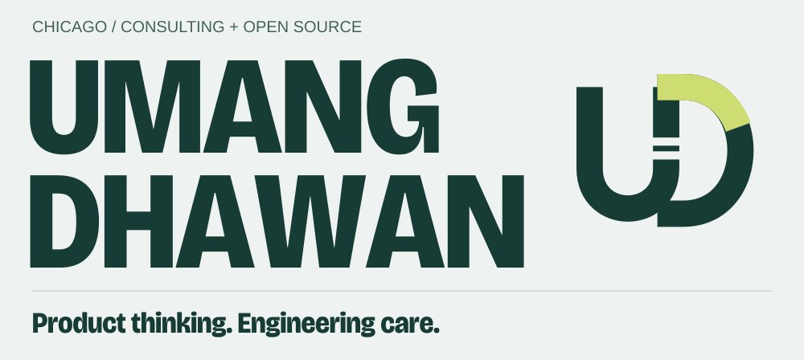
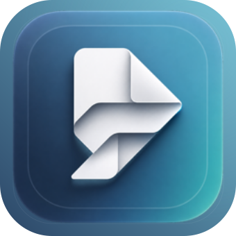
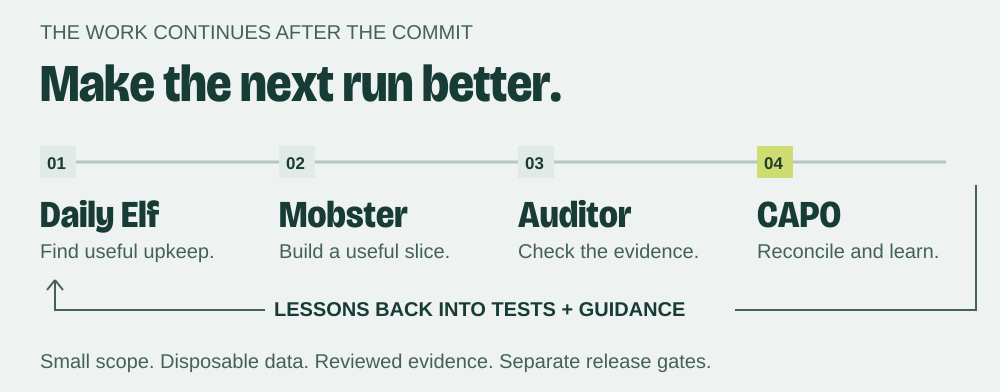

<picture>
  <source media="(prefers-color-scheme: dark) and (max-width: 700px)" srcset="./assets/profile-studio/masthead-mobile-dark-static.svg">
  <source media="(max-width: 700px)" srcset="./assets/profile-studio/masthead-mobile-light-static.svg">
  <source media="(prefers-color-scheme: dark)" srcset="./assets/profile-studio/masthead-dark-static.svg">
  
</picture>

I'm **Umang**, a **Senior Consultant at EY Studio+ in Chicago**. I work across product strategy, quality engineering, cloud reliability, and applied AI. Outside client work, I build open-source tools and keep improving them after the first release.

I like the parts that make a product dependable: a clear workflow, an honest explanation, a safe update, and a useful way back when something fails.

**[LinkedIn](https://www.linkedin.com/in/umangdhawan97)** · **[Email](mailto:umangdhawan97@gmail.com)** · **[Portfolio](https://udhawan97.github.io/)**

[Work](#selected-work) / [Maintenance](#scheduled-maintenance) / [Learning](#visual-learning) / [Experience](#experience)

## Selected work

###  &nbsp; Orifold

**Many files. One clear PDF.** A native Mac workspace for combining, reading, annotating, and signing documents. Local files, careful recovery, and the details that make a desktop app feel at home.

`Swift` `PDFKit` `macOS` &nbsp; [Explore](https://udhawan97.github.io/Orifold/) · [Source](https://github.com/udhawan97/Orifold)

###  &nbsp; FolioOrb

**See the reasoning behind the number.** A local portfolio review tool that keeps holdings, valuation coverage, and decision history inspectable. Missing data stays visible; saved reviews preserve what was known at the time.

`Python` `FastAPI` `SQLite` &nbsp; [Explore](https://udhawan97.github.io/FolioOrb/) · [Source](https://github.com/udhawan97/FolioOrb)

###  &nbsp; Codemble

**Find your way through unfamiliar code.** Explore a real codebase as a galaxy or diagram, follow its structure, and check your understanding. The parser's evidence sets the boundary for what the map claims.

`Python` `JavaScript` `Code analysis` &nbsp; [Explore](https://udhawan97.github.io/Codemble/) · [Source](https://github.com/udhawan97/Codemble)

<strong>More projects</strong>

- **[Voyalier](https://github.com/udhawan97/Voyalier)** — a local-first workspace for trip plans, confirmations, research, and travel-day readiness. Rust, Tauri, and TypeScript.
- **[Nimanto](https://github.com/udhawan97/Nimanto)** — local job matching with inspectable evidence and candidate control. Source-distributed beta.
- **[Golavo](https://github.com/udhawan97/Golavo)** — football forecasts with uncertainty and a recorded track record. Unsigned pre-alpha.
- **[Dusori](https://github.com/udhawan97/Dusori)** — turn scattered sources into cited research briefs.
- **[Nindova](https://github.com/udhawan97/Nindova)** — private, finite games with deliberate stopping points.
- **[Vidha](https://github.com/udhawan97/Vidha)** — rehearse contingency plans with synthetic data in a local pre-alpha prototype.
- **[PalDawn](https://github.com/udhawan97/PalDawn)** — source-linked conceptual disease journeys, with anatomy work held for qualified medical review.

Each repository documents its current scope, installation options, and limitations.

## Scheduled maintenance

I organize recurring AI-assisted development into four roles. The point is to keep useful work moving, verify what actually landed, and turn recurring mistakes into better tests and instructions.

<picture>
  <source media="(prefers-color-scheme: dark) and (max-width: 1000px)" srcset="./assets/profile-studio/maintenance-mobile-dark-static.svg">
  <source media="(max-width: 1000px)" srcset="./assets/profile-studio/maintenance-mobile-light-static.svg">
  <source media="(prefers-color-scheme: dark)" srcset="./assets/profile-studio/maintenance-dark-static.svg">
  
</picture>

- **Daily Elf · upkeep.** Find a worthwhile small fix, check recent work, and leave a clear handoff.
- **Mobster at Work · delivery.** Build a bounded feature or repair, with acceptance criteria and tests.
- **Auditor · challenge.** Check behavior, look for regressions, and verify that results match the evidence.
- **CAPO · continuity.** Reconcile the work, prioritize blockers, finish ready phases, and qualify useful changes for release.

**I set the direction and permissions.** The workflow preserves active work, uses disposable test data, and keeps repository checks and required reviews in place. A source merge, a verified installer, and a published release are separate milestones. Lessons feed back into the next run.

### Follow the evidence

- **[Nimanto security release](https://github.com/udhawan97/Nimanto/releases/tag/v0.10.1)** — input and local-access boundaries, dependency repairs, and published dependency-inventory checksums.
- **[FolioOrb comparison service](https://github.com/udhawan97/FolioOrb/pull/124)** — saved review bundles compared without changing portfolio data. Independent agent review caught a calculation bug before merge, despite passing CI.
- **[FolioOrb valuation consistency](https://github.com/udhawan97/FolioOrb/pull/114)** — explain partial financial data consistently across review surfaces.

**[Agent Toolkit](https://github.com/udhawan97/agent-toolkit)** packages reusable playbooks and tooling for Codex and Claude Code. It keeps setup, permissions, and cleanup understandable. [Browse the workflows](https://github.com/udhawan97/agent-toolkit#what-you-get).

## Visual learning

**[Learnings via Graphics](https://github.com/udhawan97/learnings-via-graphics)** is my beginner-friendly visual newsletter: make a prediction, reveal an explanation, and follow accessible sources or a short video to go deeper. Topics rotate across engineering, frontier technology, everyday life, and work & money.

**Try a 20-second question.** Two paths rise 40 metres. One spans 100 metres horizontally; the other spans 400. Which has the gentler average grade?

<strong>Reveal the answer</strong>

The 400-metre path: its average grade is 10%, compared with 40% for the shorter path. The footing still needs a separate check.

[See the illustrated contour lesson](https://github.com/udhawan97/learnings-via-graphics/blob/main/editions/2026-11-15-reading-contours/brief.md) · [Try the three-story issue](https://github.com/udhawan97/learnings-via-graphics/blob/main/issues/2026-11-15.md)

[Browse the library](https://github.com/udhawan97/learnings-via-graphics/blob/main/archive.md). Briefs and answer reveals open on GitHub; the full interactive guides run locally from the downloaded source.

## Experience

**EY Studio+ · Senior Consultant · 2025–present** 
Cloud quality leadership, observability, and applied AI strategy.

**EY · Consultant · 2022–2025** 
Quality and performance engineering; federal cloud delivery.

**SAP America · IT Leadership Intern · 2021** 
SAFe product delivery with teams in Germany, the US, and India.

**MS, Information Systems** · Kelley School of Business 
**BS, Informatics** · Indiana University

---

If you're working on a difficult product or an engineering problem that needs careful follow-through, I'd like to hear about it.

**[Let's connect](https://www.linkedin.com/in/umangdhawan97)** · **[Send a note](mailto:umangdhawan97@gmail.com)**

Built for GitHub, with original vector artwork. [Design notes](design/readme-refresh/DESIGN.md) · [Maintenance guide](CONTRIBUTING.md)
